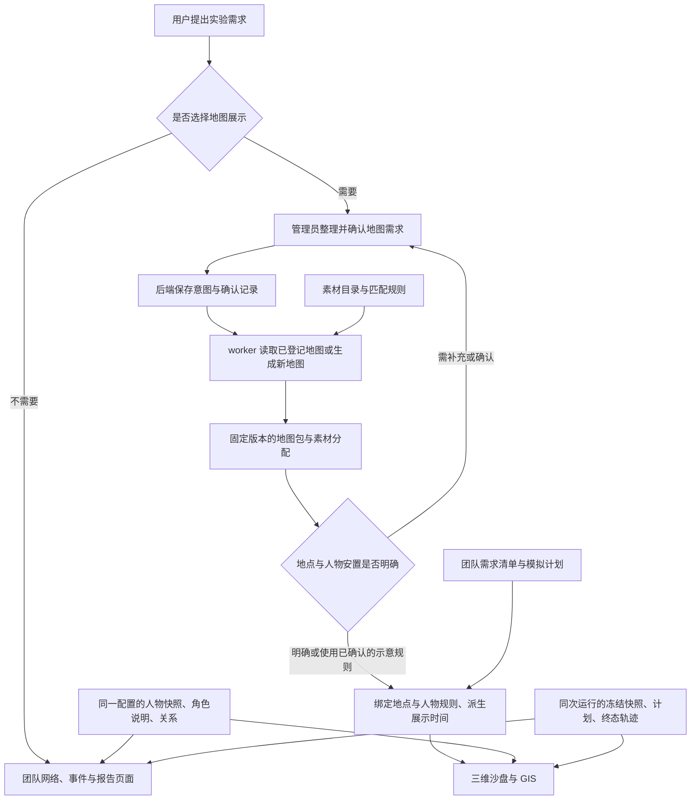

# 管理员智能体与场景模块对接草案

> 讨论稿 v0.3 · 2026-11-08 · 基于 `65bdfb7`，随里程碑 12 更新；已与 Claude 直接讨论。面向 social-sim 联调负责人、管理员智能体开发者及前端接入人员。
>
> 文中的新增 HTTP 接口、任务状态和版本字段均为建议，尚未实现，需团队确认。已实现的文件格式和接入方式分别见文末参考，不能直接把本文的请求示例当作现有接口调用。

## 0. 给对接人先读的说明

**当前接入状态：师兄已同意增加可选三维/GIS 视图，并认可同源 `/scene/` 接入方向。学弟已有本地补丁，待提交 PR；按团队规范由 Alemax067 默认审查，接口路径和部署方式在 PR 中提出并确认。尚未合并或部署。** 这表示接入方向已获认可，不表示补丁的全部实现已经获批。

据 Claude 本轮对学弟 ZIP 的复核报告，学弟已有一份包含预览入口、回放及两个只读产物接口的本地实现补丁，仍待团队审查和发布，不能写成“已接入服务器”。本轮没有独立复验该补丁或登录服务器。补丁中另外涉及取消状态的改动，应与场景接入分开审查，不自动纳入本草案范围。

两边分别负责：

- social-sim：与用户讨论实验需求、生成角色和关系、运行 OASIS、输出记录和报告。
- 场景模块：在需要地图的实验里，读取同一批人物与活动记录，提供三维沙盘/GIS 等空间展示；以后再扩展自动建图。
- 对接人：将已确认的接入方向、接口草案和嵌入包交给开发者，跟进 PR 审查，再组织验收；不需要代替所有模块开发者实现接口。

**是否需要地图取决于实验，而不是输入里有没有地名。** “讨论雄安的印象”是讨论主题，不代表讨论者都站在雄安街道上；围观网友和考虑迁入者更不能自动被安置到当地楼栋。校园咖啡案例可以选择地图展示，但目前路线和位置仍是示意，不会自动影响 OASIS 决策。

| 示例 | 建议的第一版展示 | 地图要求 |
| --- | --- | --- |
| 雄安印象、政策舆论、品牌口碑 | 团队已有网络、帖子/事件和分析结果页面 | 不要求地图，不调用场景构建，不编造人物住所或路线 |
| 校园咖啡消费 | 网络和结果页面，另可打开三维/GIS | 团队同意后绑定中科大地图；读取同一份人物与运行产物 |
| 距离影响购买、仅与附近的人交流 | 需要另外设计权威空间状态和引擎反馈 | 属于后续开发，本稿不声称现已支持 |

`/scene/` 的意思是“把场景页面放在团队网站下的一个地址”，例如网站里的“查看三维/GIS”入口。它不是服务器账号，不是模拟动作，也不是必须采用的目录名。当前嵌入包按这个基址打包，部署到别的前缀需重新构建并检查路由；最终地址和入口放哪里由团队确认。

### 0.1 现在交接给学弟的事项

> 师兄已同意把三维/GIS 做成可选视图，并认可同源 `/scene/` 接入方向。请在团队最新 main 上开开发分支，整理已有本地补丁并提交 PR，由 Alemax067 按团队规范审查。接口路径在 PR 说明中作为提议，请他审查时确认，并写清部署时场景静态包放在哪里、如何更新。取消状态相关改动与场景接入分开，按 Claude 的复核建议使用 Node 22 复验。合并部署后按联调清单检查。

接入方向不必再次单独追问；接口和部署细节在 PR 中确认。没有地图或不接场景时，团队现有模拟照常运行。

## 1. 对接目标和职责

管理员首先帮助用户确定实验与展示需求。纯线上讨论使用网络/事件展示即可；只有用户选择地图视图时，才整理地图、风格和地点需求，交给场景模块读取地图、匹配素材，生成三维沙盘和 GIS 共用的场景包。人物画像、关系和活动记录分别从团队的正式配置及运行产物读取。

地图是可选资源，不是生成角色、关系或启动 OASIS 的前提。启用地图的实验可以先准备地图，不必等人物生成或 OASIS 运行完成；已有地图包可重复使用。

**首期建议：用中科大咖啡案例验收可选地图接入，再增加地图选择和版本绑定，最后将新地图生成服务化。** 下文的新建图接口仍是建议，不要求学弟一次实现全部能力。

| 参与部分 | 负责提供或处理的内容 |
| --- | --- |
| 用户 | 先确认实验需求及是否需要地图；启用地图时再确认范围、时间和地点安排 |
| 管理员智能体（Deep Agents） | 整理需求、登记构建意图、读取结果、呈现歧义和候选项，获取用户确认；无需逐栋指定模型 |
| social-sim 后端与 worker | API 登记意图和执行权限校验，worker 实际构建；保存确认后的配置、提供版本确定的产物、存放和授权读取场景包 |
| 场景模块 | 解析地图、匹配素材、生成建筑和步行路网、推断入口、安置展示人物、提供三维/GIS 视图 |
| OASIS 引擎 | 模拟人物决策并导出活动记录；本草案不增加人物自主移动或空间感知动作 |

所有人物楼栋、入口和路线仍为展示示意。**OASIS 当前没有位置数据。** 配置预览标注“尚未运行模拟”，不生成订单或活动；没有人物数据的地图预览也不编造人物。



### 1.1 可选展示字段（新增建议，尚未实现）

建议将可选的 `visualization` 作为会话级展示偏好，或结果页上的视图开关，保存位置、字段名和枚举先请师兄确认。不要直接加进需求清单或四阶段必填输入：团队需求字段受阶段归属规则约束，随意增加字段可能触发检查或配置重生成。下文 `scene_ref` 是 `visualization.scene_ref` 的简写。`network` 使用团队现有关系网络和结果页面，场景模块不再重复开发一套网络视图。

| 字段 | 建议含义 | 校验与缺省 |
| --- | --- | --- |
| `visualization.default_view` | `network`、`gis` 或 `sandbox` | 未配置时沿用团队网络展示；管理员提出建议，用户可以选择 |
| `visualization.scene_ref` | 地图版本引用或 `null` | 网络模式允许为空；GIS/沙盘需要有效地图引用，没有地图时提示选择或准备，不用旧地图冒充 |

纯舆论实验的建议配置：

```json
{
  "visualization": {
    "default_view": "network",
    "scene_ref": null
  }
}
```

启用校园沙盘时的建议配置（编号仅为示例）：

```json
{
  "visualization": {
    "default_view": "sandbox",
    "scene_ref": {
      "scene_id": "sample-ustc-map",
      "scene_revision": 1,
      "manifest_sha256": "<地图包清单原始字节的摘要>"
    }
  }
}
```

选择网络为默认入口时，也可以保留有效地图引用以便切换；不必为了默认展示网络而删除地图。未启用地图的运行不要求地图版本、地点安置或建图任务，正常保存其人物、关系、计划和轨迹即可。增加这些字段不意味着地图已经参与智能体决策。

场景模块与主流程隔离：地图构建失败、资源缺失或子页面打不开时，仅将地图视图标为“暂无场景/加载失败”，保留同次配置或运行的网络、事件和报告入口；不得阻断配置生成和 OASIS 运行，也不得悄悄换成另一份旧地图。用户只有明确选择了已登记地图，才发起准备；讨论文本出现地名不触发自动下载。

**兼容边界：当前程序尚未实现这套自动选择展示模式的字段。** 现有嵌入版打开三维/GIS 仍固定使用中科大地图。实现本节需团队前端/后端配合；不能仅把上述 JSON 发给当前接口就认为已生效。

## 2. 管理员需要提供什么

### 2.1 启用地图时，管理员才登记地图构建意图

下表仅适用于选择地图并需要准备地图的情况；网络模式不必提供这些字段，也不发起该请求。它是建议的服务请求，不是现有 CLI 清单的直接替代。管理员提交业务字段，后端补充授权上下文；worker 解析受控输入并调用流水线。HTTP 请求或智能体工具不直接同步下载、建图，也不启动 OASIS 模拟。

| 字段 | 是否必需 | 提供方与含义 | 当前基础 |
| --- | --- | --- | --- |
| `session_id` | 是 | 从当前会话取得，由后端核对归属；建议放在接口路径中 | 配置预览已有会话上下文，场景绑定待开发 |
| `schema_version` | 是 | 新请求格式版本，例如 `scene.map-build-request.v1` | 新增包装，待开发 |
| `request_id` | 是 | 后端/调用方生成的请求编号，用于重试去重；不由模型随意复用 | 待开发 |
| `title` | 是 | 场景展示名称 | CLI 已支持 |
| `map` | 是 | 已登记地图包、OSM 范围、上传的 GeoJSON 三选一，见下表 | CLI 已支持对应输入 |
| `asset_seed` | 否 | 素材变体种子；由后端记录并映射到 builder 的 seed，缺省值也要固定 | builder 已有确定性变体；服务字段待开发 |
| `style` | 否 | 建筑风格 `yulan` 或 `procedural`，人物风格当前为 `campus` | CLI 已支持 |
| `confirmation_ref` | 提交生成时必需 | 后端保存、与会话和请求内容摘要绑定的用户确认记录；不能用模型填的 `confirmed: true` 代替 | 确认记录和检查待开发 |

不在纯建图请求中重复提交模拟步数、人物、品牌、地点/人物安置规则。地图准备好后，这些通过下面的展示绑定阶段关联；避免地图构建与人物生成互相等待。

地图输入的建议格式：

| 类型 | 服务请求中的 `map` | 后端需要做什么 |
| --- | --- | --- |
| 现成地图，首期推荐 | `{ "type": "bundle", "id": "ustc", "revision": "已登记版本" }` | 解析地图注册记录并校验包哈希；`revision` 是待增加的服务字段 |
| 新的 OSM 范围 | `{ "type": "osm", "bbox": [west, south, east, north] }` | 校验范围和大小限制，调用已有下载/转换流程，归档原始响应与来源 |
| 上传的地图 | `{ "type": "geojson", "file_id": "已登记文件编号" }` | 校验文件归属、格式、许可及坐标，解析为后端受控路径 |

只给“中科大”或“NUS”等地名不足以开始建图：应先选定已登记地图，或确认具体范围/文件。当前没有自动地名检索接口。经纬度统一为 WGS84，顺序为 `[经度, 纬度]`；其他坐标系应先明确来源并转换，不能直接混用。

当前 CLI 接受 `map.path`、`location_rules` 等本地文件路径；**未来 HTTP 接口不直接接收客户端任意文件路径或任意下载 URL**。由后端将登记的 `file_id` 解析成受控路径，再调用 CLI。地图许可、署名和数据来源随登记记录保存。

### 2.2 地图准备后，再绑定展示配置

| 内容 | 谁提供或派生 | 约定 |
| --- | --- | --- |
| `scene_ref` | 后端保存会话当前选择的地图版本 | 拟议结构为 `{scene_id, scene_revision, manifest_sha256}`，不把换地图视为四个人物配置阶段失效 |
| `config_id` | 当前配置页 | 决定读取哪份人物快照与角色说明；一次预览固定该配置与地图版本 |
| `location_rules_ref` | 场景/配置维护者与管理员确认后登记 | 指定实验地点对应，保存规则版本及所依赖的地图版本 |
| `placement_rules_ref` | 场景/配置维护者与管理员确认后登记 | 指定角色/个体安置，同时绑定人口快照与地图版本 |
| 展示起始日期、时区 | 用户确认或明确的展示默认配置 | 用于日期与光照，不宣称 OASIS 提供了真实钟点 |
| 步数、步长 | 已有需求清单和执行计划 | 当前团队 `duration_days` 对应 `plan.runtime.num_steps`，按天；未出计划仅可用已确认需求预览，出计划后核对一致。小时步长需以后明确扩展，不能猜测计划已有此字段 |
| 人物安置 seed | 回放取 `plan.runtime.seed`；预览取快照 seed 或明确缺省 | 与素材 seed 区分，冻结实际采用值及来源 |

现有 `scenario` CLI 要求完整的 `simulation_time`。未来服务可先用 `osm` / `geojson` 命令生成基础地图包，再在展示绑定阶段从团队需求/计划派生 `start/timezone/step_unit/steps`，组装现有展示清单。**不能要求管理员另外维护一份独立的模拟计划。** 这层服务组装和动态加载仍需开发。

本草案的 `scene_ref` 指地图几何与素材版本；启用地图时，时间、地点规则、人物安置及配置引用组成一次固定的展示绑定。运行时冻结整份绑定，不仅冻结地图编号；不启用地图时明确记录为空，不补出一份地图绑定。

### 2.3 两种规则必须分开

| 规则 | 回答的问题 | 已实现格式/行为 |
| --- | --- | --- |
| 地点对应规则 | “实验里的图书馆/某门店对应地图上哪个要素？” | `location_rules` 文件；可使用明确的名称/标签精确匹配，或已有地点映射；GeoJSON 也可直接带 `properties.location_id` |
| 人物安置规则 | “某角色或某个人，展示时放在哪栋楼？” | `{ "roles": {"sample_role": "building-id"}, "entities": {"sample_person": "building-id"} }`；个体优先于角色 |

明确的地点匹配不到或匹配多处时返回待处理问题，不能随机选一栋冒充真实地点。人物未指定安置时，现有程序按种子和角色计算稳定的兜底楼栋，并标为示意；不根据姓名或画像猜测住址。两种机制的规则、版本和用途不能混为一项。

素材挑选由场景模块执行：地图标签与素材目录规则决定原型，种子决定变体。未识别的建筑可使用明确的通用建筑原型；地图没有的轮廓、真实高度或完整建筑细节不能凭模型补造为事实。这是依地图生成的风格化场景，不等于精确复原校园建筑。

选择现成 `bundle` 时，当前流程沿用包中已有的素材分配；仅修改场景清单的风格或 seed 不会重新匹配包内原型。若要求重新选素材或变体，需要重建地图包。人物兜底安置使用的种子仍须单独保持一致。

### 2.4 人物与回放数据由后端提供，不让管理员重新编写

| 使用阶段 | 必需输入 | 对接要求 |
| --- | --- | --- |
| 配置预览 | 同一 `session_id + config_id` 的 `network.payload.snapshot` 与 `roles.payload.population_request` | 保留快照编号、版本、人物 ID、画像和关系；中文字段名取 `GeneratedField.title`，角色说明取 `description` |
| 运行回放 | 运行详情、该次冻结快照、该配置的计划、终态 `trajectory.json` | 核对快照和计划的 ID、revision；不能换用之后重新生成的配置 |
| 品牌与门店 | 计划的 `economy.brands[]`、`economy.products[]` | 按 `brand_id → owner_entity_id → 展示楼栋` 关联；不假设品牌 ID 等于人物 ID，也不限制两家店 |

人物和品牌来自正式产物，不从聊天文本重新生成一份。模型可以帮助用户提出或确认地点安排，但不能改写既有画像、关系、订单或 OASIS 决策结果。

## 3. 场景模块返回什么

### 3.1 已有的文件输出

现有命令：

```sh
python -m adapter.scene_builder scenario --manifest scenario.json
```

生成的场景包包含以下内容；部分文件仅在输入具备对应数据时输出：

| 输出 | 内容 |
| --- | --- |
| `campus3d.json` | 局部米制坐标中的建筑、道路、边界、水域等地图信息；通用边界可能只是输入范围，不一定是行政校界 |
| `asset_assignments.json` | 地图要素与素材原型、参数、变体、来源和许可的对应 |
| `landcover.json` | 地表要素 |
| `location_mapping.json` | 有效的地点对应，存在映射时输出 |
| `entrances.json` | 每栋楼的推断入口与道路连接，仍为示意 |
| `gis/*.geojson` | WGS84 建筑、道路、地表、水域、边界、点位、入口图层 |
| `scenario.json` | 展示时间、样式、场景元信息、文件清单及 SHA-256 |
| `scenarios/index.json` | 已生成场景的目录，供页面选择场景 |

“命令行已生成文件”不等于“团队已有建图 API”。上述能力还需包装成后端服务，动态私有包也不能直接放入公开场景目录。

### 3.2 建议的服务返回（待开发）

构建可能涉及下载和模型准备，建议用后台任务返回进度。管理员获取摘要和问题列表，浏览器读取场景包，不把全部几何和素材二进制塞进智能体上下文。

| 字段 | 用途 |
| --- | --- |
| `job_id`、`status`、`stage` | 标识任务、当前状态及处理阶段；没有可靠百分比时只返回阶段 |
| `scene_id`、`scene_revision` | 标识一份不可变的已准备场景版本，构建完成后返回 |
| `manifest_url`、`manifest_sha256` | 同源、受权的地图包清单地址及其原始字节摘要；清单内再校验每个文件。绑定后另有展示清单，不混用摘要 |
| `map_revision`、`catalog_revision` | 固定地图和素材目录版本，支持复现；优先使用内容摘要 |
| `builder_revision`、`input_sources` | 构建代码版本、原始地图摘要、获取时间与来源记录；用于区分同范围的不同数据快照 |
| `locations` 或 `locations_url` | 地图要素/地点目录及稳定 ID、名称、类别；OASIS 地点对应和人物安置在绑定后附加，记录规则与示意来源 |
| `summary` | 建筑/道路/素材匹配数量、默认高度数量、通用原型兜底等摘要；默认高度不能说成实测 |
| `warnings`、`confirmation_items` | 缺少高度、道路不连通、地点匹配歧义等问题和候选项 |
| `views.sandbox`、`views.gis` | 同一地图版本的两个展示入口；完成人物/时间绑定后再返回对应配置或运行入口 |
| `attribution`、`data_visibility` | 数据/素材来源、许可、署名；访问范围默认 `private`，不能因嵌入包公开就自动公开团队数据 |
| `error.code`、`error.message` | 失败时可判断的错误码和可读中文说明 |

建议任务状态：`queued → running → completed`；需用户补充时为 `needs_confirmation`，无法处理时为 `failed`。**这些任务状态尚未实现，且不同于 OASIS 的运行状态。** 地图任务的 `completed` 表示地图准备完成，不表示模拟已经执行。地点安置产生的待确认项由后续绑定流程处理，不应阻塞无关地图的几何准备。

### 3.3 请求与响应示例（全部为拟议格式）

建议由后端先校验确认记录和会话，再接收以下请求；示例中的版本、编号和统计数字仅用于说明，不是实测数据：

```json
{
  "schema_version": "scene.map-build-request.v1",
  "request_id": "sample-request-001",
  "title": "中科大高新校区 · 场景预览",
  "map": {"type": "bundle", "id": "ustc", "revision": "sample-map-r1"},
  "asset_seed": 2026,
  "style": {"buildings": "yulan", "characters": "campus"},
  "confirmation_ref": "sample-confirmation-001"
}
```

提交后返回 HTTP 202：

```json
{"job_id": "sample-job-001", "status": "queued"}
```

查询到构建完成后返回以下结构。地址、`scene` 参数、摘要和版本字段均为新增接口示意，当前嵌入页尚不支持该动态地图参数：

```json
{
  "job_id": "sample-job-001",
  "status": "completed",
  "scene_id": "sample-scene-001",
  "scene_revision": 1,
  "map_revision": "sample-map-r1",
  "catalog_revision": "sample-catalog-r1",
  "manifest_url": "/api/sessions/sample-session/scenes/sample-scene-001/revisions/1/manifest.json",
  "manifest_sha256": "<实际清单原始字节的64位十六进制摘要>",
  "summary": {"buildings": 12, "roads": 20, "default_height_buildings": 9},
  "locations_url": "/api/sessions/sample-session/scenes/sample-scene-001/revisions/1/locations",
  "warnings": [],
  "confirmation_items": [],
  "data_visibility": "private",
  "attribution": [{"source": "OpenStreetMap", "license": "ODbL-1.0", "credit": "© OpenStreetMap contributors"}],
  "views": {
    "sandbox": "/scene/mecoffe3d/?session=sample-session&scene=sample-scene-001&scene_revision=1",
    "gis": "/scene/mecoffe-gis/?session=sample-session&scene=sample-scene-001&scene_revision=1"
  }
}
```

## 4. 接口放在哪，以及怎样接

### 4.1 建图服务接口建议（全部待确认、待开发）

| 接口 | 用途 |
| --- | --- |
| `POST /api/sessions/{session_id}/scene-builds` | 登记确认后的建图意图，返回任务编号 |
| `GET /api/sessions/{session_id}/scene-builds/{job_id}` | 查询状态、待确认项、错误及完成结果 |
| `GET /api/sessions/{session_id}/scenes/{scene_id}/revisions/{revision}/...` | 只读提供已登记版本的场景清单、允许列表内文件及地点目录 |

建议将路由和权限放在 social-sim 主应用的 API/服务层，worker 调用场景模块的纯转换函数或 CLI；场景转换代码不直接读写团队数据库。管理员的 Deep Agents 工具调用同一业务服务，不另建一套绕过登录的建图接口。

选择地图、确认规则和保存展示绑定的接口沿用团队的“登记意图、worker 执行、读取结果”方式；具体工具名与保存位置待团队确认。地点候选只用于供用户选择，不应绕过确认直接改配置。

文件引用、身份和归属由后端校验。缺失文件应返回错误，不能返回 HTML 或另一份旧场景。HTTP 包装应增加范围/文件大小限制、超时及请求去重；同一 `request_id` 在同一会话下重复提交应返回原任务，内容不同则明确冲突。这些均是服务化开发内容。

HTTP 层沿用团队错误约定：未登录 401，对象不存在或无权访问 404，状态冲突 409，输入不合法 422，响应使用既有 `{detail: ...}` 格式；后台任务查询中的 `error.code/message` 是任务结果，不另起一套登录错误协议。

服务端提供带哈希的包文件时应保留原始字节，不能先解析 JSON 再重新序列化或改变换行符。文件列表须受允许列表约束；可复用的基础几何与私有展示绑定分别存放，后者默认不公开。

### 4.2 现有预览与回放入口

以下是场景子应用已具备的技术接入方式。同源 `/scene/` 接入方向已获师兄认可，但具体补丁、接口路径和部署方式仍须经 PR 审查；不能据此认为服务器已经部署或当前网页已经接通。

配置预览客户端已读取：

```text
GET /api/sessions/{session_id}/configs/{config_id}/stages/network
GET /api/sessions/{session_id}/configs/{config_id}/stages/roles
```

已有嵌入入口，不带拟议的动态地图参数：

```text
/scene/mecoffe3d/?session=<session_id>&config=<config_id>
/scene/mecoffe-gis/?session=<session_id>&config=<config_id>
```

运行回放客户端已经按以下草案实现并用 mock 测试；团队服务端接口是否落地仍需联调确认：

```text
GET /api/sessions/{session_id}/runs/{run_id}
GET /api/sessions/{session_id}/runs/{run_id}/artifacts/trajectory
GET /api/sessions/{session_id}/runs/{run_id}/artifacts/population-snapshot
GET /api/sessions/{session_id}/configs/{config_id}/stages/plan
GET /api/sessions/{session_id}/configs/{config_id}/stages/roles
```

其中运行详情、plan 和 roles 是已有接口约定，两个 `artifacts` 在学弟本地补丁中有待审实现，最终路径在 PR 中确认。运行的 `config_id` 必须来自运行详情。roles 只补充角色名称和字段标题，缺失或不合格时沿用冻结快照说明或原名；401 仍提示登录失效，取消请求不吞掉。回放入口使用 `session + run`，与配置预览区分。网页、`/scene/` 资源和 `/api/` 应同源，浏览器沿用登录 Cookie，子应用不处理令牌。

### 4.3 版本与复现

- 会话可保存当前 `scene_ref`，允许为空；启用/关闭展示或换地图不应无端触发 roles/personas/network/plan 四阶段重生。若地图以后参与决策，则另行定义依赖失效规则，本期不默认如此。
- 配置预览绑定 `session_id + config_id + snapshot_id + snapshot_revision`；启用地图时再固定本次加载的 `scene_ref` 和规则版本。页面不在加载途中自动换用会话新地图。
- 运行启动时冻结运行对应配置、快照和计划版本；若启用地图，再冻结场景版本、地图/素材目录摘要、安置规则、时间与 seed，未启用则记录空引用。后续修改配置不能改变旧运行的回放。
- `scene_revision` 是地图与展示配置版本；`snapshot_revision` 是人口快照版本；二者不可互相替代。当前包的 `scenario.json` 是文件清单，不等于已经存在服务端的 revision 管理。
- 原始 OASIS 轨迹保留 `kind: oasis.interaction_trajectory`、`schema_version: "1.0"`；本文不要求改其现有格式。新增服务请求与场景包各用自己的格式版本。
- 固定地图响应、构建代码、素材目录、规则及 seed 后才能要求可复现。对实时 OSM 重新下载，原始地图可能已变化，不能承诺结果字节相同。
- 团队人物与运行数据只经授权 API 读取，不进入公开 Pages 或嵌入静态包；SHA-256 用于完整性校验，不能代替登录和归属检查。

## 5. 已实现、待联调、待开发

| 能力 | 状态 | 边界或下一步 |
| --- | --- | --- |
| 素材目录、类别匹配、确定性变体与来源许可记录 | 已实现 | 管理员不必逐个选素材 |
| OSM/GeoJSON/已有包的 CLI 建图，入口、GIS 和文件哈希 | 已实现 | 适合受控命令行调用；尚无建图 HTTP 服务 |
| 三维和 GIS 共用场景包，公开场景目录选择 | 已实现 | 公开包目录不等于团队私有场景注册服务 |
| 任意角色的配置预览、中文属性、楼内人数与关系 | 客户端已实现，团队侧有待审本地补丁（据 Claude 报告） | 读取 network/roles，不生成活动；不等于服务器已接通 |
| 通用品牌回放、版本校验及被拒/未知动作展示 | 客户端已实现，团队侧有待审本地补丁（据 Claude 报告） | 真实运行联调待完成，不能据此声称接口已上线 |
| `/scene/` 静态子应用和同源读取模式 | 接入方向已认可；团队本地补丁待提 PR、待审查部署 | Alemax067 默认审查，接口及部署在 PR 中确认；嵌入地图固定为中科大 `config-map` |
| 按实验选择网络/GIS/沙盘、可空地图引用 | 新增建议，待确认与开发 | 未配置时保持团队网络流程；不把本文示例当成现有接口 |
| 管理员收集地图需求、保存确认记录并登记建图意图 | 待开发 | 与管理员配置流程及团队后端一起接，worker 实际执行 |
| 建图任务、授权包读取、地图注册与版本冻结 | 待开发 | 新接口和返回字段须先确认；失败不阻断主模拟流程 |
| 嵌入页按配置加载动态私有地图 | 待开发 | 不能只改 iframe 参数就自动换地图 |
| 任意地图的 Python 原始轨迹转换链 | 尚需改造 | 现有 `scenario.py` 原始轨迹分支仍引用旧 `scene/campus.json`；前端通用回放已另行实现，不应混称 |
| 人物根据距离/位置自主决策、空间查询与移动动作 | 后续独立阶段 | 当前不实现、不影响本轮预览接入 |

## 6. 建议实施顺序与验收

0. **整理已有补丁并提 PR。** 接入方向已获认可，学弟按团队规范整理分支和测试，由 Alemax067 默认审查，接口及部署方式在 PR 中确认。
1. **合并部署后验收现成中科大地图的配置预览。** 由部署负责人挂载嵌入包并加可选入口，场景负责人协助按 [联调清单](scene-integration-checklist.md) 核对人数、关系、画像、楼内统计，以及登录失效和阶段未完成提示。此步不依赖建图服务或真实 OASIS 运行；雄安印象案例继续走网络分支。
2. **增加地图选择与展示绑定。** 会话保存当前地图版本，预览固定地图与配置，运行冻结整份展示绑定；先让管理员选择已登记地图。现有嵌入代码需增加地图解析，不能声称已经支持任意地图。
3. **把已有流水线服务化。** 实现建图任务与受权包读取，先使用受控现成包，再开放 OSM 范围和 GeoJSON 上传；添加时间/规则校验、失败提示、去重和摘要。
4. **完成运行回放联调。** 提供两个只读运行产物接口，拿一次终态运行验证冻结输入、成功订单、被拒/未知结果和两种视图的一致性。可与前面步骤并行。

新场景服务的最低验收：网络实验在 `scene_ref: null` 时照常生成配置和运行，不发起建图、不安置虚构人物；启用地图时，相同归档地图/目录/规则/seed 生成结果一致，三维与 GIS 指向同一场景版本；地点歧义必须报出；配置重生不改变旧回放；无轨迹时不编造事件；授权和缺失处理可测；团队私有数据不进入静态发布目录。

## 7. 请师兄和学弟确认的事项

**已确认：**

1. 三维/GIS 作为可选视图，纯舆论实验继续使用团队现有网络页面；师兄认可同源 `/scene/` 接入方向。
2. 学弟补丁仍待提 PR、审查、合并和部署；方向认可不等于代码获批。
3. 按团队规范由 Alemax067 默认审查，接口路径和部署方式在 PR 中提出并确认，无需再单独追问审查人。

**开发者在 PR 或后续设计中确认：**

- 可选 `visualization` 设置保存位置、地图及规则版本的冻结方式，避免触发无关四阶段重生。
- 场景包和两个回放产物接口的最终路径、权限及来源版本。
- 已有接入代码做到哪一步，哪些待验收、哪些尚未部署，再划分任务，避免重复开发。
- 自动建图、管理员工具和用户确认流程放在哪一阶段实现；不作为第一版接入的先决条件。

## 8. 参考与讨论记录

- [现有嵌入与人物数据接入说明](social-sim-integration.md)：当前 `session/config`、`session/run` 读取方式、同源部署及回放接口草案。
- [现有地图输入契约](map-input-contract.md)：CLI 输入、地图坐标、素材匹配、场景包与哈希。
- [GIS 架构](gis-architecture.md)：地图生成、人物层和可替换显示层的边界。

本轮已向 Claude 发起直接评审并收到回复，纳入的建议包括：管理员只登记意图、worker 执行；首期已登记地图；模拟时间由需求/计划派生；会话选地图、运行冻结；来源许可、默认高度统计与私有默认。草案保留服务端确认记录校验，并明确两类规则及旧 Python 轨迹路径的限制。最终字段、接口路径和负责人仍由团队确认后，再据此拆分开发任务。

2026-11-08 里程碑 12 修订：接入状态按师兄最新回复更新为“同意可选视图及同源 `/scene/` 方向”，审查默认 Alemax067，接口和部署在 PR 中确认。学弟本地补丁仍待提 PR、审查、合并和部署。无地图分支、可空引用和新建图服务依然是待开发的建议，不因本次文档更新自动生效。
